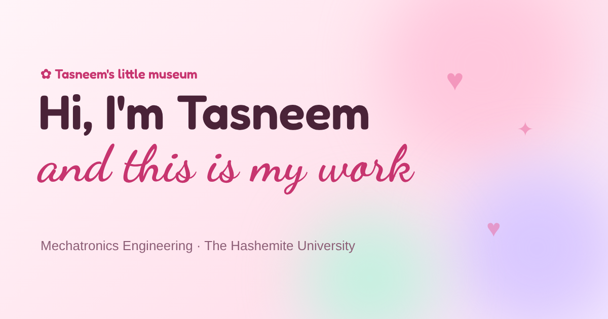

# Tasneem's Little Museum

Personal portfolio of **Tasneem Mhairat**, Mechatronics Engineering student
at The Hashemite University. It's a playful digital museum: projects hang as
polaroids, milestones line a timeline, visitors sign a guestbook, and Hello
Kitty pops in now and then to say hi.



> **Live at:** https://tsneem6.github.io/digital-museum/ (once GitHub Pages is switched on)
>
> **Setting it up for the first time?** Read **[START-HERE.md](START-HERE.md)**.
> It's a step-by-step guide that needs no coding.

## Features

| | |
| --- | --- |
| **Fast & smooth** | Native scrolling, a ~100 KB (gzipped) first download, and heavier parts (project popup, editor, guestbook) loaded only when needed. |
| **Splash** | A heart draws itself and fills with pink, then the page opens through a circle. About 1.3 s, once per visit, skipped for reduced motion. |
| **Light & dark mode** | Follows the visitor's system setting; the ☾ / ☀︎ button switches and remembers. Every colour is a theme token. |
| **Top of the page** | Floating pill navbar, a "Hi, I'm Tasneem" greeting with her favourite categories, and a "museum pass" ID card with her photo and stats. |
| **Currently working on** | A pinned sticky note with an emoji and a progress bar. |
| **My favourite** | A fanned pile of the project's photos with a rosette, next to "why I love it". |
| **Project parade** | A strip of mini polaroids that glides past by itself and pauses on hover. |
| **Project showcase** | Polaroid cards with search and emoji category chips. Cards open into the full story, photos and teammates. Visitors can ♡ a project. |
| **My story so far** | A horizontal road of milestones (swipe, drag or arrows), oldest to newest, with "📍 I'm here now". |
| **Giving back** | Cards with photo strips, year badges and roles. |
| **Cursor** | A pink arrow that becomes a heart over anything clickable, with a little sparkle trail. Pure CSS, so it never lags. |
| **Hello Kitty** | Peeks in from the edges every 20–45 s. Hover to keep her, click for a "hi!". |
| **Bilingual** | English / العربية, with right-to-left layout. |
| **Editor** | 🔑 in the navbar. A login card, then a drawer with a sidebar of sections, a one-page project form with a live preview, ↑ ↓ reordering, a sticky Save bar, "Saved!" messages, and a 🚀 Publishing page that tests the GitHub connection. While logged in, ✎ Edit buttons appear on every section and an editing bar floats at the bottom. |

## Configuration

- **`site.config.js`**: name, GitHub username/repo, categories and their
  emoji, project statuses, founding year. This is the only file that has to
  be edited before the first deploy.
- **`src/data/projects.js`**: all content. The Editor rewrites this file.
- **`src/i18n/en.json`, `ar.json`**: all wording.
- **`src/index.css`**: colour tokens (`:root` = light, `[data-theme='dark']` = dark).
- **`src/theme.css`**: the playful layer (rounding, pills, script accents).

### Secrets (GitHub → Settings → Secrets and variables → Actions)

| Secret | Needed for |
| --- | --- |
| `VITE_SUPABASE_URL`, `VITE_SUPABASE_ANON_KEY` | Editor login and guestbook |
| `VITE_TURNSTILE_SITE_KEY` *(optional)* | Cloudflare Turnstile spam check on the guestbook |

The site works without any of them: the guestbook shows "not configured
yet" and the Editor can't log in.

### Optional: Ask the Curator
An AI chat on each project that answers using only that project's write-up
(Google Gemini free tier). Run `supabase/migrations/curator_rate_limit.sql`,
then `curator_rate_limit_atomic.sql`, and deploy the function:

```bash
npx supabase secrets set GEMINI_API_KEY=... TURNSTILE_SECRET_KEY=...
npx supabase secrets set PROJECTS_RAW_URL=https://raw.githubusercontent.com/tsneem6/digital-museum/main/src/data/projects.js
npx supabase functions deploy ask-curator --no-verify-jwt
```

Then add the Actions **variable** `VITE_CURATOR_ENABLED` = `true` and redeploy.

## Development

```bash
npm install
npm run dev            # live dev server at http://localhost:5173/digital-museum/
npm run build          # production build in dist/
npm run build:preview  # double-clickable test copy in preview/ (with a demo editor)
npm run lint
```

Copy `.env.example` to `.env.local` to try the Editor login and guestbook
locally.

## Notes

- Hello Kitty is a character owned by Sanrio. The drawing here is an
  original fan illustration for a personal, non-commercial site. Remove
  `<HelloKitty />` from `src/App.jsx` if the site is ever used commercially.
- The ♡ counters use the free [counterapi.dev](https://counterapi.dev)
  service under the `likesNamespace` set in `site.config.js`.
